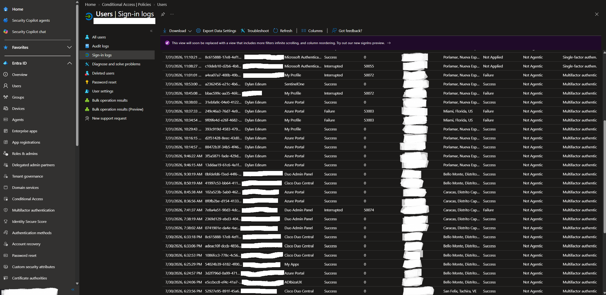
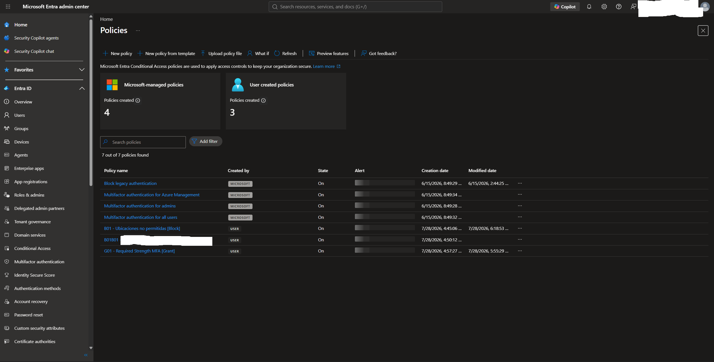
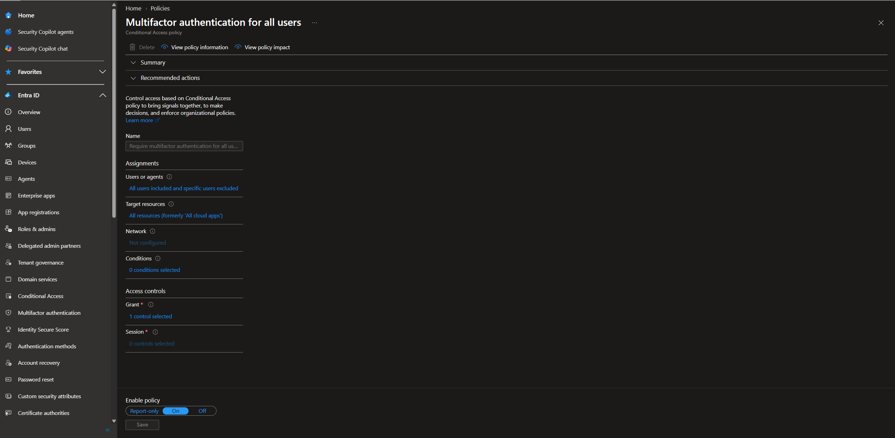
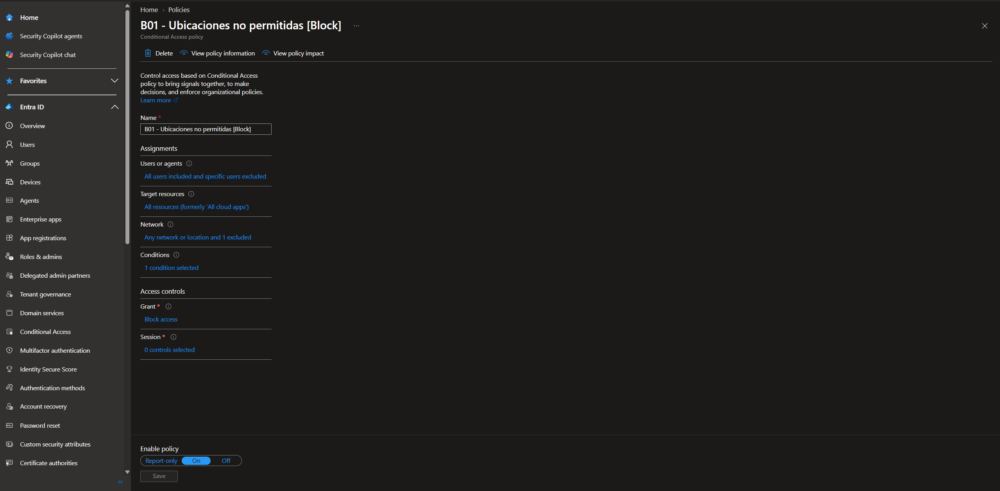
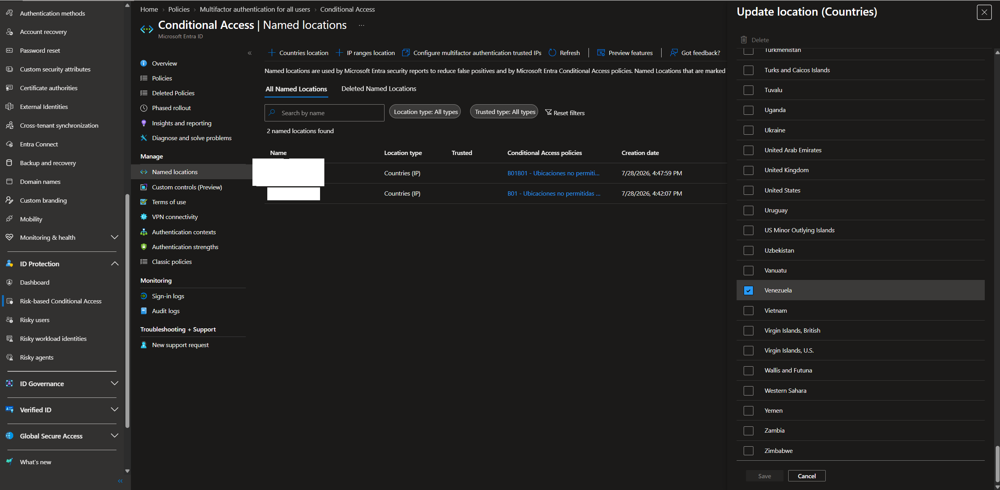
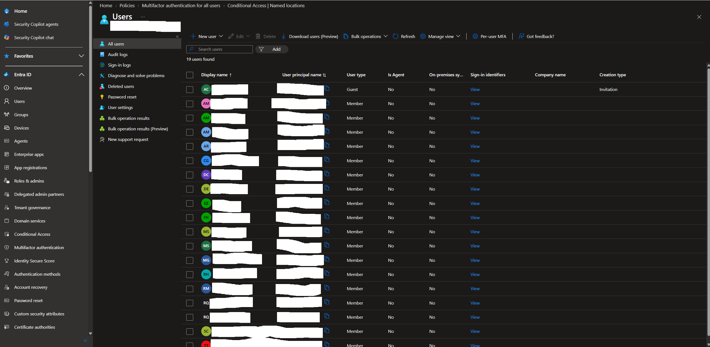

# Entra ID Hardening Guide

**Microsoft Entra ID | Identity Security | IAM Hardening**

## Objective

Document and audit the Microsoft Entra ID security configuration of a production tenant, using the CIS Benchmark and Microsoft security best practices as reference. The project covers Conditional Access policy analysis, MFA enforcement, sign-in log monitoring and location-based access controls, and ends with a gap analysis and a list of recommended hardening actions.

> **Privacy note:** the tenant name, domains and public IP addresses have been anonymized or masked on purpose. Screenshots are redacted.

- **Environment:** Production tenant, Microsoft Entra ID P1
- **Organization:** Venezuelan services company (name withheld)
- **Role used:** Global Administrator (see Finding F-01: a read-only role would have been enough for this audit)
- **Tools:** Microsoft Entra Admin Center, Conditional Access, Sign-in Logs
- **Last updated:** November 2026 (screenshots taken July 2026)

## Environment / Architecture

| Component | Details |
|---|---|
| Identity Provider | Microsoft Entra ID (formerly Azure AD) |
| License | Microsoft Entra ID P1 |
| Users | 19 accounts: 18 members + 1 guest (B2B invitation) |
| Conditional Access policies | 7 active (4 Microsoft-managed, 3 user-created) |
| MFA | Enforced via Conditional Access for all users (exclusions pending documentation, see F-03) |
| Location controls | Country-based blocking via Named Locations |
| Default domain | Cloud-only *.onmicrosoft.com domain |

## Implementation Steps

### 1. Sign-in Log Analysis

Reviewed user sign-in logs to identify authentication patterns, geographic anomalies and policy enforcement in action.

Key findings:

- Normal activity originated from Porlamar, Nueva Esparta, VE (IP 190.200.x.x, masked) and other Venezuelan cities (Caracas, Bello Monte, San Felix).
- Two failed attempts came from Miami, Florida, US (IP 146.70.x.x, masked) with error code **53003** (access blocked by Conditional Access).
- Those attempts belong to the audit account itself, and successful sign-ins from Porlamar happened minutes before and after. A geographic jump that fast is not physically possible, so the most likely explanation is **traffic through a VPN or proxy exit node**, not an external attacker. It is treated here as a policy-enforcement test, not as a confirmed intrusion.
- Applications observed: SentinelOne, Azure Portal, Cisco Duo Admin Panel, ADIbizaUX, My Profile, Microsoft Authenticator.

Error codes seen in the logs:

| Code | Meaning |
|---|---|
| 53003 | Access blocked by Conditional Access |
| 50072 | User must enroll in MFA |
| 50074 | Strong authentication required (MFA challenge) |
| 50055 | Password expired |

Security implication: the location-based blocking policy actively stops sign-ins from non-permitted countries.

### 2. Conditional Access Policies, Overview

The tenant has 7 active Conditional Access policies.

| Policy | Created by | State | Purpose |
|---|---|---|---|
| Block legacy authentication | Microsoft | On | Prevents legacy protocol attacks |
| MFA for Azure Management | Microsoft | On | Protects admin operations |
| MFA for admins | Microsoft | On | Secures privileged accounts |
| MFA for all users | Microsoft | On | Baseline MFA enforcement |
| B01 - Ubicaciones no permitidas | User | On | Blocks non-permitted countries |
| B01B01 - [REDACTED] | User | On | Extended location block |
| G01 - Required Strength MFA | User | On | Enforces an Authentication Strength for MFA |

### 3. MFA Enforcement Policy, All Users

Analysis of the Microsoft-managed policy enforcing MFA across all users and all cloud applications.

- Users: all users included, specific users excluded
- Target resources: all resources (all cloud apps)
- Network: not configured (applies globally)
- Additional conditions: none
- Grant: require multifactor authentication
- State: On

Security implication: any user reaching any cloud application must complete MFA regardless of location or device. This applies the Zero Trust principle of "verify explicitly".

**Note on single-factor entries in the logs:** a few rows in the sign-in screenshot show "Single-factor authentication" with Conditional Access "Not Applied" (Microsoft Authenticator and My Profile, with codes such as 50055 and 50072). These look like password-expiry and MFA-registration flows, where the user has not completed MFA yet. This has to be confirmed (see F-03), because it is the exact scenario that policy exclusions and registration gaps create.

### 4. Location-Based Access Control, B01 Block Policy

Analysis of the user-created policy that blocks access from non-permitted countries.

- Users: all users included, specific users excluded
- Target resources: all resources
- Network: any network or location, with 1 location excluded (the permitted locations)
- Conditions: 1 condition (location)
- Grant: block access
- State: On

This policy generated the 53003 events observed in the logs.

### 5. Named Locations Configuration

The tenant uses Named Locations to define the permitted geographic zones.

- 2 named locations configured
- Type: Countries (IP-based)
- Venezuela selected as the permitted country
- Linked to policies B01 and B01B01

Limitation: country detection is IP-based, so a VPN with a Venezuelan exit node bypasses it. It should be combined with device-based and authentication-strength controls (see Recommendations).

### 6. User Directory, IAM Overview

- 19 accounts in total: 18 members and 1 guest
- The guest was created by invitation (Azure AD B2B)
- Members use the tenant's cloud-only default domain

Best practice: review guest permissions periodically and apply a dedicated Conditional Access policy to external identities.

## Results

| Security control | Status | Evidence |
|---|---|---|
| MFA enforced for all users | Active (exclusions to document) | CA policy On |
| Legacy authentication blocked | Active | CA policy On |
| Location-based access control | Active, bypassable by VPN | B01 policy On |
| MFA for privileged accounts | Active | CA policy On |
| Authentication Strength required | Active (strength not yet documented) | G01 policy On |
| Sign-in log monitoring | Manual review only | Logs reviewed |
| Geographic anomaly | Detected and blocked (likely own VPN) | Error 53003 |

## Findings and Gaps

| ID | Finding | Risk | Recommendation |
|---|---|---|---|
| F-01 | The audit was done with a permanent Global Administrator role | Medium | Use Global Reader or Security Reader for audits. With P1 there is no PIM, so keep the number of Global Administrators to a minimum and review them regularly |
| F-02 | No break-glass (emergency access) accounts documented | High | Create 2 cloud-only emergency accounts, excluded from CA, with long random passwords stored offline and alerts on any sign-in |
| F-03 | Policy exclusions are not documented ("specific users excluded") | High | List every excluded user or group per policy, justify each one, and review quarterly. Only break-glass accounts should be excluded from MFA |
| F-04 | Country blocking can be bypassed with a VPN in the permitted country | Medium | Add a device-compliance or hybrid-join requirement for sensitive apps and phishing-resistant MFA for admins |
| F-05 | No dedicated Conditional Access policy for the B2B guest | Medium | Create a guest-specific policy (MFA, restricted apps, session controls) and review guest access |
| F-06 | Sign-in logs are kept only 30 days on P1 | Medium | Export logs via diagnostic settings to Log Analytics or Sentinel for retention and alerting |
| F-07 | G01 Authentication Strength and B01B01 not analyzed in depth | Low | Document the exact strength (for example phishing-resistant: FIDO2, Windows Hello, certificate) and the scope of B01B01 |
| F-08 | Interaction between Cisco Duo and Entra MFA not documented | Low | Document which one is the authoritative second factor, to avoid double prompts and gaps |

## Additional Recommendations

- Create new policies in **report-only mode** first, check the impact in the sign-in logs, and only then switch them to On.
- Block device code flow and legacy authentication, and review the Authentication Methods policy (disable weak methods such as SMS where possible).
- Enable Entra Password Protection and review Identity Secure Score regularly.
- Risk-based policies (sign-in risk and user risk) require Entra ID P2.

## CIS Benchmark Mapping (indicative)

The Conditional Access controls are in the Microsoft Entra section of the **CIS Microsoft 365 Foundations Benchmark** (section 5.2.2 in recent versions; numbering changes between versions, so verify it against the version you use).

| Control area | Observed state | Related finding |
|---|---|---|
| MFA for administrative roles | Compliant | F-01 |
| MFA for all users | Compliant, exclusions pending | F-03 |
| Block legacy authentication | Compliant | |
| Phishing-resistant MFA for admins | To verify (G01) | F-07 |
| Managed or compliant device requirement | Not implemented | F-04 |
| Sign-in and user risk policies | Not available (needs P2) | |
| Emergency access accounts | Not documented | F-02 |

## Lessons Learned

- **Conditional Access is Zero Trust in practice.** The B01 policy blocks out-of-region access automatically and leaves clear evidence in the logs.
- **Error codes are investigative leads.** 53003 pointed straight to a policy block. A SOC analyst uses these codes to tell policy enforcement apart from real attack attempts, and context (same user, minutes apart, VPN) matters before calling something an attack.
- **Layered policies reduce blast radius.** Separate policies for legacy auth, MFA, location and MFA strength can be tuned independently (defense in depth).
- **Exclusions and exceptions are the weak point.** A policy is only as strong as its exclusion list.
- **Audit with least privilege.** Even for a hardening audit, use the lowest role that does the job.
- **Guest accounts need dedicated controls** so they do not inherit over-permissive access from member policies.

## References

- [Microsoft Entra Conditional Access documentation](https://learn.microsoft.com/entra/identity/conditional-access/)
- [CIS Microsoft 365 Foundations Benchmark](https://www.cisecurity.org/benchmark/microsoft_365)
- [CIS Microsoft Azure Foundations Benchmark](https://www.cisecurity.org/benchmark/azure)
- [NIST SP 800-63B, Digital Identity Guidelines](https://pages.nist.gov/800-63-3/sp800-63b.html)
- [Microsoft Entra sign-in error codes](https://learn.microsoft.com/entra/identity-platform/reference-error-codes)
- [Zero Trust security model, Microsoft](https://learn.microsoft.com/security/zero-trust/zero-trust-overview)

---

Project developed as part of the SOC Analyst Jr. certification roadmap: SC-900, CompTIA Security+, SC-200.

**Author:** Dylan Edum | July 2026 (revised November 2026)
